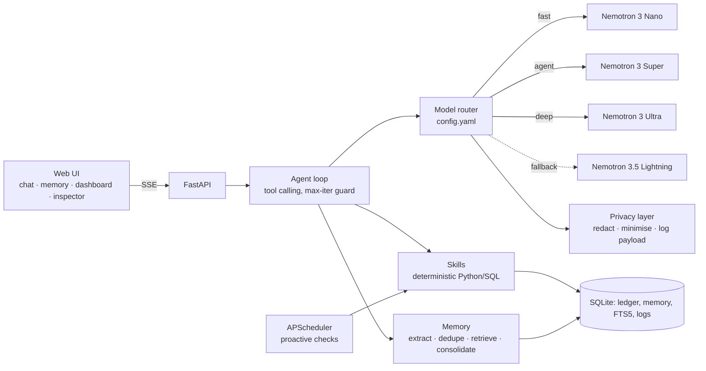

# Ledgermind v2 build plan

The repo already had a working v1 (route → remember → act → answer, nine skills, vanilla UI, offline mock). v2 keeps
what worked (CSV parsing, Nano thinking handling, mock-first testing, the single-file SQLite ledger) and rebuilds it
into the architecture of the brief: a real tool-calling agent on Nemotron Super, a config-driven model router, typed
persistent memory, a privacy layer with an inspector, proactive checks, eval and benchmark.

## Architecture



## File tree

```
config.yaml                 model chains, timeouts, privacy, scheduler, currency
ledgermind/
  config.py                 config.yaml + .env -> typed Settings
  db.py                     SQLite schema and connection (FTS5 for memory)
  money.py                  currency formatting (INR lakh grouping, USD)
  logs.py                   structured JSON logging
  llm/        client.py (Token Factory + mock), router.py, jsonutil.py, mock.py
  privacy/    redact.py, minimise.py, inspector.py
  memory/     store.py, extract.py, retrieve.py, consolidate.py
  skills/     registry + one module per skill family
  agent/      loop.py, prompts.py, numguard.py
  proactive/  checks.py, scheduler.py
  server.py   FastAPI + SSE
  static/     single-page UI (no build step)
scripts/      generate_demo_data.py, check_models.py, benchmark.py
eval/         questions.yaml, run_eval.py
tests/        pytest, LLM mocked; one live test behind LEDGERMIND_LIVE_TESTS=1
docs/         nebius_notes.md, plan.md, decisions.md, deploy_nebius.md
```

## Phases (commit after each, app runnable throughout)

1. Foundation: config, logging, Token Factory client with mock mode, router with retries/timeouts/fallback and call
   logging, doc-verified model IDs, Makefile, FEEDBACK.md started.
2. Data and skills: schema, CSV import with header detection, seeded 12-month demo data, categorisation
   (corrections first, rules, then Nano), summary, subscriptions, anomalies, with tests.
3. Memory and privacy: typed memory store with dedupe/merge, Nano extraction, FTS5 + recency/importance retrieval,
   consolidation, PII redaction, aggregate-only minimisation, payload log for the Privacy Inspector.
4. Agent: tool loop on Super, system prompt, number guard, streaming endpoint, goals, budgets, what-if, monthly review.
5. UI: chat with streamed answers and expandable tool steps, model + latency badges, memory panel, dashboard,
   proactive cards, Privacy Inspector with strict-mode toggle.
6. Proactive and deploy: APScheduler checks, Dockerfile, Nebius AI Cloud serverless notes.
7. Polish: eval with pass-rate table, benchmark script, README, SUBMISSION.md, video script, FEEDBACK.md, checklist.
